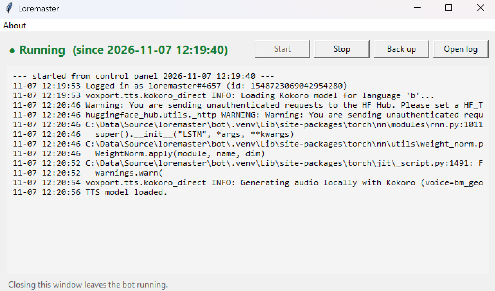

# Loremaster

A Discord bot for a group of friends who play video games together, powered
by Claude. Mention it in a channel to get game recommendations, help
choosing tonight's game, or advice mid-session: builds, tactics, quests,
rules. It remembers each campaign between sessions, reads screenshots, and
can speak its replies in a voice channel.

Loremaster is **self-hosted**. Each group runs its own copy, with its own
Discord bot, its own Anthropic API key, and its own costs. Nobody runs a
shared instance for you.

## What it does

- Answers when @mentioned in any channel it can see. It doesn't jump into
  other conversations.
- Has a persona and a group profile that you write: who's in the group,
  what you like to play, and how it should talk.
- Takes game extensions: extra instructions per game, switched live when
  the group changes campaigns.
- Remembers each campaign (party state, objectives, memorable moments) in
  a local SQLite database, so it survives restarts.
- Reads image attachments (character sheets, inventory screens) and `.md`
  or `.txt` files.
- Can reply with a downloadable Markdown file instead of a chat message.
- Looks up live Steam data (price, co-op support, player counts) and
  searches the web for recent patch notes and news.
- Keeps a wish list and bug reports from the group, about the bot itself.
  The owner can pass any item on to the developer as a pre-filled GitHub
  issue.
- **Voice output:** speaks its replies in a voice channel ("speak on").
- **Voice input (experimental, off by default):** listens in a voice
  channel and answers when someone says its wake word. This needs a
  separate speech-to-text server.

## Quick start (Windows)

You need Python 3.12, Git, and ffmpeg (ffmpeg only for spoken replies).

```
git clone https://github.com/brienalkire/loremaster.git
cd loremaster\bot
python -m venv .venv
.venv\Scripts\activate
pip install -r requirements.txt
copy ..\.env.example ..\.env
```

Then:

1. Create a Discord application and bot, turn on **Message Content
   Intent**, and copy its token. [MANUAL.md](MANUAL.md#1-create-the-discord-bot)
   walks you through it.
2. Get an Anthropic API key from [console.anthropic.com](https://console.anthropic.com/).
3. Put both in `.env`:

   ```
   DISCORD_BOT_TOKEN=...
   ANTHROPIC_API_KEY=...
   ```

4. Start the bot from `bot\` with `python main.py`, or use the desktop
   control panel (`powershell -File make_shortcut.ps1` makes a desktop
   shortcut for it).
5. Invite the bot to your server ([MANUAL.md](MANUAL.md#4-invite-the-bot-to-your-server))
   and say `@YourBot hello`.

The control panel starts and stops the bot, backs up its database, and
shows the latest lines of its log:



It starts with a generic example persona. Write your own next:
[MANUAL.md](MANUAL.md#persona-and-game-extensions) explains how.

The first start takes a while, because it downloads the speech model
(about 330 MB).

## Documentation

- [MANUAL.md](MANUAL.md): full setup, configuration, personas and game
  extensions, voice, backups, privacy, costs, and troubleshooting.
- [HOW_TO_TALK_TO_LOREMASTER.md](HOW_TO_TALK_TO_LOREMASTER.md): a short
  guide to share with your group members.
- [bot/README.md](bot/README.md): developer notes, including how voice
  input works and why it needs a pinned py-cord commit.
- [CHANGELOG.md](CHANGELOG.md)

## Status

Loremaster is a hobby project, used every week by one group. It's tested
on Windows 11 with Python 3.12. The bot itself is plain Python and should
run on Linux or macOS, but that hasn't been tested, and the desktop control
panel is Windows-only.

It's distributed from GitHub only, not PyPI. Voice input depends on an
unreleased py-cord commit, and PyPI doesn't allow that kind of dependency.

## Licence

MIT. See [LICENSE](LICENSE).
